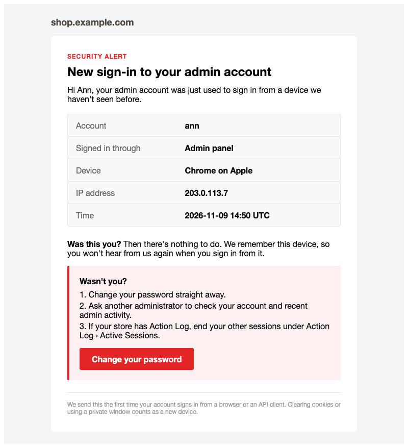

# New Device Sign-in Alerts for Magento 2 Admin

Email an admin user when their account signs in from a device it hasn't used before.

Magento Open Source doesn't tell an admin when their account is used somewhere new, so a stolen password can go
unnoticed. This module recognises each admin's devices and sends a security alert the first time the account signs
in from an unknown one. Admin panel sign-ins and admin token requests over the web API are both covered.

## Features

- **New-device alert**: the first sign-in from an unknown device emails the account's owner. Known devices stay
  quiet.
- **Real device recognition**: each browser gets its own random token in a cookie, so a stolen password used on
  another "Chrome on Windows" machine still raises an alert.
- **Web API sign-ins covered**: admin token requests over REST, SOAP or GraphQL alert too. An integration alerts
  once, and again when it connects from a new IP address.
- **Clear alert email**: account, admin panel or web API, browser and OS, IP address and time (UTC), the admin
  host for people who run several stores, and a *Wasn't you?* box with a **Change your password** button.
- **Never blocks a sign-in**: if the email, cookie or database step fails, the error is logged and the admin signs
  in as normal.
- **Privacy-minded storage**: only a SHA-256 hash of each device token is stored, never the token itself.

## How it works

After a successful password check (before two-factor authentication), the module looks for the admin's device
cookie. If the device is known, it records the IP address and time and does nothing else. If not, it remembers the
new device and emails the admin. Each admin user on a shared browser has their own cookie, so they don't reset each
other's devices.

## Screenshots

Screenshots of the emails as sent (Luma theme, 2026-11-09).

**New sign-in alert**



## Good to know

- Clearing cookies, a private window, or a new browser profile counts as a new device and sends an email.
- A known device signing in from a new IP address does not trigger an alert (web API clients excepted, see above).
- Device records are kept; old devices are not cleaned up automatically.
- The alert goes to the admin user whose account signed in, not to a central security address.

## Requirements

- Magento Open Source 2.4 (developed on 2.4.8)
- PHP 8.3 or 8.4
- Magento modules: Backend, Email, User
- `cbschuld/browser.php` ^2.0 (installed by Composer)

## Installation

```
composer require tonyapps/module-notify-on-new-browser-login
bin/magento module:enable Tonyapps_NotifyOnNewBrowserLogin
bin/magento setup:upgrade
```

## Configuration

- **Stores > Configuration > Advanced > Admin > Security > New Device Sign-in Email**: the email template. The
  module works with the default template out of the box.

## Redesigning the emails

Choose the template in **Stores > Configuration > Advanced > Admin > Security > New Device Sign-in Email**. Pick a
template made in **Marketing > Email Templates**, or a design made with the
[Email Designer](https://github.com/tonyappsorg/magento2-email-designer) (`Tonyapps_EmailDesigner`) in
**Marketing > Communications > Email Designer**. The default template is used until another one is picked.

## For developers

Architecture, decisions, data model and tests are in [AGENTS.md](AGENTS.md).
